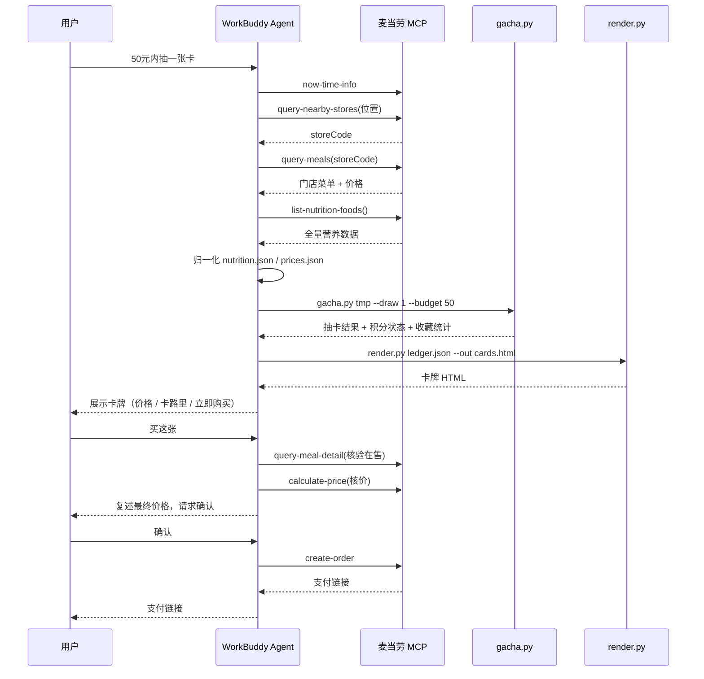

# MCP 集成说明 · MCP_INTEGRATION

本文档说明「麦卡收藏家」**实际使用**的麦当劳 MCP 能力、调用流程与业务价值。

## 一、使用的 MCP Server

| 项目 | 值 |
|---|---|
| Server 名称 | `mcd-mcp` |
| 官方文档 | <https://open.mcd.cn/mcp/doc> |
| 接入地址 | `https://mcp.mcd.cn` |
| 传输协议 | Streamable HTTP |
| 鉴权方式 | 请求头 `Authorization: Bearer <MCD_MCP_TOKEN>` |
| 限流 | 每 Token 600 次/分钟，超限返回 429 |
| 配置示例 | [`mcp-config.example.json`](mcp-config.example.json)（仅含环境变量占位符，无真实凭证） |

### Token 获取方式

`MCD_MCP_TOKEN` 需**自行申请**（AI 无法代办，需人工扫码登录）：

1. 打开 <https://open.mcd.cn/mcp>，右上角点「登录」
2. **扫码登录**麦当劳开放平台账号
3. 右上角点「控制台」→ 弹窗中点「激活」
4. 同意服务协议 → 一键复制 MCP Token

### 为什么后端必须自持 Token

WorkBuddy 注入的 `mcd-mcp` connector 实际指向**本机代理**
（形如 `http://127.0.0.1:60551/<hash>/mcp`），其 `Authorization` 是
**代理临时票据**（附带加密的 `X-WorkBuddy-MCP-Context`），并非官方 Token：

- 直连 `mcp.mcd.cn` 会返回 **401 Unauthorized**（已实测）
- 该票据与本机进程绑定，**公网服务无法使用**
- 且它是内部凭证，**不应写进代码或部署配置**

因此线上后端必须持有**自己在开放平台申请的官方 Token**，
且该 Token **只存在于服务端环境变量**，绝不下发到浏览器。

## 二、后端服务架构

线上形态从「纯静态页」升级为「零依赖 Python 后端 + 静态页」：

```
deploy/app-dist/
├── app.py           HTTP 服务：静态托管 + /api/stores + /api/order
├── mcd_client.py    MCP 客户端（stdlib 复现 Streamable HTTP 握手）
└── docs/            网页静态资源
```

| 端点 | 方法 | 作用 |
|---|---|---|
| `/` | GET | 静态网页 |
| `/api/health` | GET | 探活 + 是否已配置 Token |
| `/api/stores` | POST | 城市+地点 → 附近门店（按 `distance` 升序） |
| `/api/order` | POST | `step=quote` 核价；`step=confirm` 真实下单 |

### 下单的强制二次确认（服务端强制，不可绕过）

```
前端点击购买
   ↓
POST /api/order {step:"quote", store, items}
   ↓ 服务端调 MCP calculate-price
返回 {price, quoteToken, needsConfirm:true}
   ↓ 前端展示总价，等用户点击「确认下单」
POST /api/order {step:"confirm", quoteToken}
   ↓ 服务端校验 quoteToken（一次性、15 分钟过期）
调 MCP create-order
   ↓
返回 {orderId, payH5Url}
```

安全约束：

- `create-order` **只接受** `step=confirm` + 有效 `quoteToken`，
  伪造 token 直接 409 拒绝（已实测）。
- `quoteToken` **一次性**：核价时绑定 `items` + `store`，
  防止前端篡改商品或价格绕过核价直接下单。
- 下单失败会把报价退回，允许用户重试。
- 每 IP 每分钟最多 30 次 API 调用。

## 三、使用的 Tool 清单

本项目实际调用以下 9 个麦当劳 MCP Tool，覆盖「定位 → 取价格 → 取营养 → 抽卡渲染 → 下单」全链路：

| # | Tool | 用途 | 调用时机 |
|---|---|---|---|
| 1 | `now-time-info` | 获取当前时间，判断时段与活动 | 每次开场 |
| 2 | `query-nearby-stores` | 定位附近门店（到店场景） | 进入页面 / 换店 |
| 3 | `delivery-query-addresses` | 查询配送地址（外送场景） | 外送定位时 |
| 4 | `delivery-query-stores` | 查询可配送门店（外送场景） | 外送定位时 |
| 5 | `query-meals` | **当前门店可售菜单、价格与餐品图** | **卡牌价格 + 卡面图片来源** |
| 6 | `query-meal-detail` | 确认餐品在售与套餐详情 | 购买转单前核验 |
| 7 | `list-nutrition-foods` | **全量餐品营养数据（约 160 项）** | **卡牌热量来源** |
| 8 | `calculate-price` | 商品价格计算（含券） | **下单前核价（强制）** |
| 9 | `create-order` | 创建订单并返回支付链接 | **用户二次确认后** |

> 其中 `query-nearby-stores`、`query-meals`、`list-nutrition-foods`、
> `calculate-price`、`create-order` 是构成核心价值的五个关键 Tool。

### ⚠️ 已知约束：MCP 不返回门店坐标

实测 `query-nearby-stores` 返回的每家门店：

| 字段 | 实测值 | 说明 |
|---|---|---|
| `distance` | ✅ 真实值（米） | **唯一可用的距离来源**，前端按此升序排序 |
| `longitude` | ❌ 恒为 `0.0` | **不可用于计算距离** |
| `latitude` | ❌ 恒为 `0.0` | 同上 |

因此「定位最近门店」只能走**「城市 + 地点关键词」文本搜索**，
无法在前端用 GPS 坐标做最近门店计算（既无坐标，也无安全的数据通道）。

## 三、调用流程



## 四、数据流：从 MCP 返回到卡牌

MCP 返回的是业务原始结构，需归一化为 `gacha.py` 的输入契约：

```
MCP 返回                            gacha.py 输入
──────────────                ─────────────────────
query-meals.items[]       ──────►   prices.json + 卡面图片
  .name / .currentPrice/{餐品名: 售价}
  .code                /           .product_code
  .image               /           .image_url（官方菜单图）

list-nutrition-foods[]    ──────►   nutrition.json .items[]
  .productName / .energyKcal /         .productName / .energyKcal /
  .protein / .fat /                     .protein / .fat /
  .carbohydrate / .sodium                .carbohydrate / .sodium / ...

用户自然语言               ──────►   CLI 参数
  "50元内抽一张"                       --budget 50 --draw 1
```

gacha.py 再基于这两份数据派生卡牌属性：

| 派生字段 | 计算方式 | 用途 |
|---|---|---|
| `health_score` | 蛋白质密度 35% + 低热量 40% + 低钠 25% | 稀有度划分、卡面进度条 |
| `rarity` | ≥75→SSR；≥55→UR；否则 R | 卡牌稀有度 |
| `price_tier` | 价格分档 A/B/C/D | 卡面标签 |
| `category` | 餐品名关键词匹配 | 卡面品类标签 |
| `image_url` | 直接取自 `query-meals` 的 `meals[].image` | 卡面官方菜单图 |
| `product_code` | 直接取自 `query-meals` 的 `meals[].code` | 下单时的餐品编码 |

### 卡面图片来源

`query-meals` 返回的 `meals[].image` 即麦当劳官方菜单图（`menu-img.mcd.cn` CDN），
可直接作为卡面使用，无需自制：

- 35 张卡**全部**使用该字段，映射关系记录在 `tools/image_map.py` / `.json`；
- 映射表经 HTTP HEAD 探测验证可访问性，缺失项（如「双层深海鳕鱼堡」）
  通过探测 ProductPool 路径补齐；
- `parity_check.py` 校验图片字段完整性、CDN 域名、URL 唯一性共 8 项；
- 网页端 `` 自动降级为品类 emoji，加载失败不影响游戏进行。

详细的字段映射表见
[`skills/mcd-gacha-collector/references/mcp-tools.md`](skills/mcd-gacha-collector/references/mcp-tools.md)。

### 卡池交集约束

卡池只保留 **「`query-meals` 门店在售」 ∩ 「`list-nutrition-foods` 有营养数据」** 的餐品：

- 门店卖不到 → 无法用卡面「立即购买」，剔除；
- 无营养数据 → 无法标注卡路里，剔除；
- 两者都有 → 进入卡池。

这样保证用户抽到的每一张卡都**既能标注营养、又能真实下单**。

## 五、业务价值

1. **让营养数据可感知**：160 个餐品的热量、蛋白质、钠含量原本是抽象数字，
   变成一张张可收集、可对比的卡牌，把"高热量"转化为看得见的稀有度差异。
2. **用玩法引导更轻的选择**：把低卡高蛋白餐品设为 SSR，
   让相对更轻的选择在收集玩法中更有吸引力，而无需做营养说教。
3. **价格透明、零跳转**：卡面标注门店实时价格并内置「立即购买」，
   从"想吃"到"下单支付"全在对话内完成。
4. **零消费门槛**：积分账本完全本地化，**不消耗用户真实麦当劳积分**，
   不影响官方积分体系，也不对账户做任何写操作。
5. **可扩展**：新增餐品只需补充 `nutrition.json` / `prices.json`，
   无需改动抽卡逻辑；卡面图片由用户自制，与代码解耦。

## 六、核验说明（供评审参考）

- `scripts/sample_data/` 中的数据为**脱敏演示样本**，字段结构与 MCP 真实返回一致，
  数值为 MCP 实际返回值；
- 真实运行时，餐品价格来自 `query-meals` 实时返回，营养数据来自 `list-nutrition-foods`，
  代码中不含任何真实 Token / 密钥 / 账号凭证；
- 引擎可离线运行：`python scripts/gacha.py scripts/sample_data --inspect`
  与 `python scripts/selftest.py`（105 项断言）均无需网络；
- 复现步骤：配置好 MCP Token → 安装 Skill → 对话「50元内抽一张卡」
  → 观察 Agent 调用上述 Tool 并输出卡牌页面。