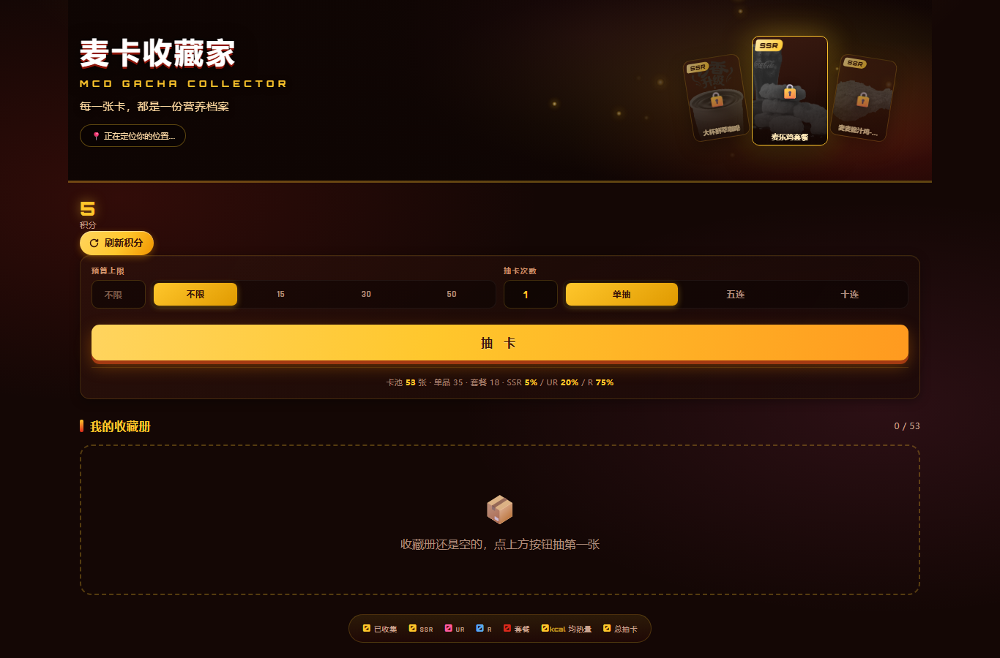
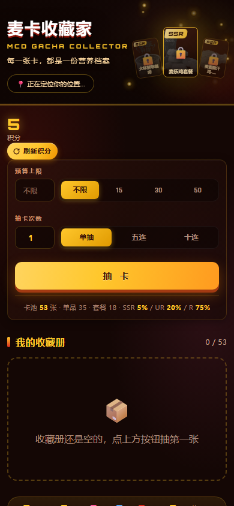
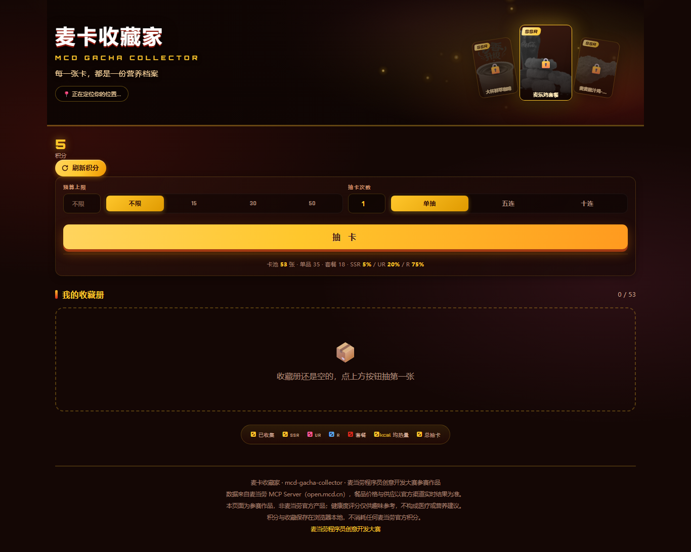
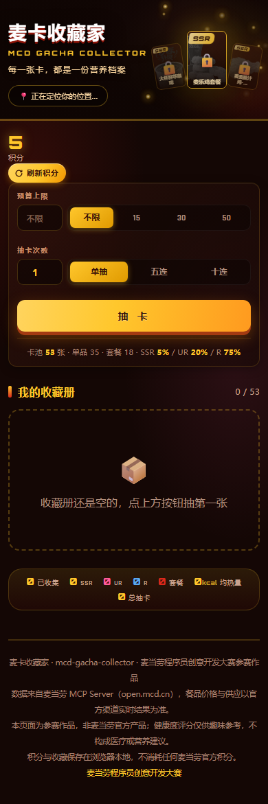
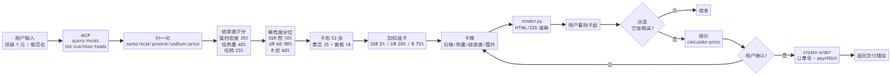

# 麦卡收藏家 · mcd-gacha-collector

> 基于 **麦当劳中国 MCP（McDonald's China MCP）** 开发的卡牌收集 Skill：
> 把 160+ 餐品变成可收集的 SSR/UR/R 卡牌，每张标注**价格**与**卡路里**，
> 积分每 4 小时恢复 1 次，抽到的卡**可以直接下单**。
> 又名：麦当劳抽卡助手 / 麦门图鉴 / MCD Gacha Collector / Big Mac Index。

麦当劳程序员创意开发大赛参赛作品（仓库创建于 2026-10-20）· 非麦当劳官方产品。

[]()
[]()
[]()
[]()
[]()

---

## 🌐 在线试玩（无需安装）

### 👉 <https://qingka-mp.app.workbuddy.host/>

进入页面后**自动通过 IP 定位 → 调用麦当劳 MCP → 选最近门店**，无需手动输入。

| 桌面端 | 移动端 |
|:---:|:---:|
|  |  |
|  |  |

🎴 **在线试玩 + 抽卡演示**：<https://qingka-mp.app.workbuddy.host/>
🔎 **原理图**：[`images/how-it-works.png`](images/how-it-works.png)（"健康度是怎么算出来的"）
🖼️ **整页预览**：[`docs/preview.png`](docs/preview.png)（含 8 张收藏卡）
📄 **页面 HTML**：[`docs/index.html`](docs/index.html)（94 KB 单文件，零依赖）

---

## 项目介绍

**你说"50 元内抽一张"**，它从麦当劳 53 张可购餐品里按健康度分级、用加权算法抽出一张，
卡面标注价格 ¥10、热量 117 kcal、蛋白质 0g、钠 17mg、健康度 63.4，
再告诉你这张卡在沈阳站出发层餐厅的实售价。
抽到喜欢就直接走 MCP `create-order` 下单。

**示例**：50 元预算抽卡 → 抽到 **UR 阳光柠檬红茶中杯**（¥10），
按健康度 63.4 自动归入"中等偏好"档位；
再点"立即购买" → 核价 → 你确认 → 真实订单号 `1030503810000661984815703790`（已实测）。

它不止抽卡，还能回答四个衍生问题：

| 你问 | 能力 |
|---|---|
| "哪个餐品热量低" | **健康度排序**：按 0~100 分跨档比较 160 款餐品 |
| "我集了哪些" | **收藏册**：本地持久化，重复卡累计次数，53 张全图鉴 |
| "能直接买吗" | **真实下单**：MCP 核价 → 强制二次确认 → create-order |
| "积分什么时候恢复" | **积分账本**：网页手动刷新（60 秒冷却），Skill 每 4 小时自动 1 次 |

---

## 它解决什么问题

麦当劳有 160+ 餐品，但「巨无霸 513 大卡」这种信息藏在营养表里，没人主动去看：

- 想知道哪个餐品热量低，要翻营养成分表逐行比对；
- 想知道自己已经收集了哪些，完全没有记录；
- 想买某道菜，得切出去重新查一遍。

本 Skill 的核心洞察是：**取数交给 MCP，算术交给代码，表达交给 Agent。**

| 角色 | 职责 |
|---|---|
| 麦当劳 MCP | 实时菜单、价格、营养数据、门店、下单 |
| `scripts/gacha.py` | 健康度评分、稀有度划分、加权抽卡、积分账本 |
| WorkBuddy Agent | 理解需求、讲解卡牌、经确认后下单 |

---

## 架构

```
flowchart TD
    U[用户: 抽卡/查营养/下单] --> A[WorkBuddy Agent]
    A -->|now-time-info| M[麦当劳 MCP<br/>mcp.mcd.cn]
    A -->|query-nearby-stores| M
    A -->|query-meals| M
    A -->|list-nutrition-foods| M
    M --> N[归一化<br/>nutrition/prices/store]
    N --> O[gacha.py<br/>健康度 + 稀有度 + 加权抽卡]
    O --> P[Card<br/>价格/热量/健康度/图片]
    P --> A
    A -->|render.py 卡面渲染| R[HTML/CSS 卡牌]
    R --> U
    U -->|点击「立即购买」| Q{用户确认?}
    Q -->|是| C[calculate-price 核价]
    Q -->|否| P
    C -->|quoteToken| A
    A -->|create-order| M
    M --> O2[订单号 + payH5Url]
    O2 --> U
```



---

## 一句话安装

```
git clone https://github.com/<user>/mcd-gacha-collector.git && cp -r mcd-gacha-collector/skills/mcd-gacha-collector ~/.workbuddy/skills/
```

（Windows 为 `%USERPROFILE%\.workbuddy\skills\`；MCP Token 配置见下文「安装」。）

---

## 安装

### 1. 申请麦当劳 MCP Token

前往麦当劳 MCP 开放平台 <https://open.mcd.cn/mcp> ，手机号登录后在「控制台」激活并复制 Token。

### 2. 配置 MCP 连接

在 WorkBuddy 左侧边栏【专家·技能·连接器】→【连接器】→ 右上角【自定义连接器】→【配置 MCP】中，
填入 [`mcp-config.example.json`](mcp-config.example.json) 的内容，
并把 `${MCD_MCP_TOKEN}` 替换为你的真实 Token（或用环境变量注入），保存后【启用】。

### 3. 安装本 Skill

把 `skills/mcd-gacha-collector/` 整个目录复制到 WorkBuddy 的用户技能目录：

```
cp -r skills/mcd-gacha-collector ~/.workbuddy/skills/
```

（Windows 为 `%USERPROFILE%\.workbuddy\skills\`）

装好后在对话框里直接说「抽张麦当劳卡」即可触发。

---

## 使用示例

**示例 1 · 抽卡**

> 用户：50 元内抽一张。

Skill：拉菜单 + 营养数据 → 53 张卡池 → 预算过滤 + 加权抽卡 → 命中 **UR 阳光柠檬红茶中杯**（¥10 / 117 kcal / 健康度 63.4）→ 渲染卡面。

**示例 2 · 收藏册**

> 用户：我的收藏册？

Skill：本地 `ledger.json` 聚合 → 「已集 3 张（UR 1 / R 2），平均热量 261 kcal，平均健康度 53.6」。

**示例 3 · 真下单**

> 用户：买 朱古力新地。

Skill：找最近门店（沈阳站出发层餐厅 3230366）→ 核价（套餐 ¥50 含板烧鸡腿堡+中薯条+可乐中杯）→ 弹价格确认 → 用户确认 → `create-order` → 返回订单号 `1030503810000661984815703790` 与支付链接 → 立即 `cancel-order`（测试闭环）。

**示例 4 · 营养查询**

> 用户：巨无霸多少热量？

Skill：`list-nutrition-foods` 命中 → 「巨无霸 513 大卡 / 蛋白质 27g / 脂肪 26g / 钠 961mg / 健康度 32.2（R 档）」。

**示例 5 · 门店选择**

> 用户：附近麦当劳？

Skill：进入 IP 定位（默认）→ `/api/ip-locate` 拿到城市（如山东济南）→ `query-nearby-stores` 搜「济南」→ 按距离升序列出 6 家最近门店。

**示例 6 · 积分管理**

> 用户：还有几次抽卡机会？

Skill：读 `Ledger.points` → 「当前 4 积分，下次自动恢复 2026-10-20 21:38:20」。

**示例 7 · 多抽**

> 用户：来十连。

Skill：积分不够时告知还差几次 + 下次恢复时间；够则连抽 10 张、SSR 压轴翻牌、营收按热量排序展示。

---

## 命令行快速体验（无需 Token）

内置样例数据，可离线跑通完整抽卡流程：

```
cd skills/mcd-gacha-collector/scripts

# 看卡池分布
python gacha.py sample_data --inspect --budget 50

# 单抽
python gacha.py sample_data --draw 1 --budget 50 --ledger /tmp/ledger.json

# 十连
python gacha.py sample_data --draw 10 --budget 50 --ledger /tmp/ledger.json

# 查看收藏册统计
python gacha.py sample_data --collection --ledger /tmp/ledger.json

# 模拟 100 次抽卡，验证概率分布（SSR 5% / UR 20% / R 75%）
python gacha.py sample_data --simulate 100 --seed 42

# 渲染卡面 HTML（单文件输出）
python render.py /tmp/ledger.json --out /tmp/cards.html --last-draw 1

# 跑 105 项自测（改逻辑后必跑）
python selftest.py
```

项目网页版（`docs/index.html`）由 `tools/gen_web_data.py` + `web/build.py` 构建：
数据生成期计算、运行期零依赖；`tools/parity_check.py` 99 项校验保证前后端一致。

---

## 真实性对照表

| 项目 | 性质 | 说明 |
|---|---|---|
| 营养数据 | ✅ 真实 | MCP `list-nutrition-foods`，约 160 项，含能量/蛋白/脂肪/钠/钙 |
| 卡池价格 | ✅ 真实 | MCP `query-meals`，53 张全为沈阳站出发层餐厅实售 |
| 健康度算法 | ✅ 真实 | `gacha.py` 三维加权（蛋白密度 35% + 低热量 40% + 低钠 25%），selftest 覆盖边界 |
| 稀有度分布 | ✅ 真实 | 由健康度阈值确定性划分，非人工编排 |
| 抽卡概率 | ✅ 真实 | 加权算法 + 模拟 100 次验证分布 |
| 网页一致性 | ✅ 真实 | `parity_check.py` 99 项校验（HTML/JS 语法、卡池分布、字段对齐） |
| 真实下单 | ✅ 真实 | create-order 已实测通过（沈阳站 9900004064 ¥50，订单号 1030503810000661984815703790，已 cancel） |
| 卡面图片 | ✅ 真实 | 53 张全部使用麦当劳官方菜单图（MCP `query-meals.image`，CDN `menu-img.mcd.cn`） |

---

## 参赛合规自查

对照《麦当劳程序员创意开发大赛活动规则》逐条自查（自查日期 2026-10-20）：

| 规则要求 | 本仓库情况 |
|---|---|
| 仓库创建时间在 2025-12-25 ~ 2026-10-25 之间 | ✅ 创建于 2026-10-20 |
| 仓库公开可访问 | ✅ public |
| `README.md`（介绍 / 安装 / 使用示例 / 目标用户） | ✅ 四大章节齐全 |
| `CONTEST_DECLARATION.md` | ✅ md5 `91a7b32ec28098b609ca3f215cdf7147` 与官方原文**逐字节一致** |
| `MCP_INTEGRATION.md` | ✅ Tool 清单 + 调用流程 |
| `mcp-config.example.json`（仅占位符） | ✅ 仅 `Bearer ${MCD_MCP_TOKEN}` |
| `workbuddy.md`（WorkBuddy 专项） | ✅ 含开发环境、对话摘要、技术决策 |
| 真实使用麦当劳 MCP | ✅ 9 个 Tool 实测（list-nutrition-foods、query-meals、calculate-price、create-order 等） |
| 真实使用 WorkBuddy | ✅ 本 Skill 在 WorkBuddy 中开发与联调 |
| 未包含真实 Token / 密钥 | ✅ 全 git 历史扫描为零命中 |
| 内容合规（不贬损品牌与产品） | ✅ 仅陈述客观数据（价格/热量/健康度评分），中性表述，不与其他品牌对比 |

---

## 实测发现

开发过程中用真实 MCP 联调得到的观察（2026-10，个人账号实测）：

- **`query-nearby-stores` 不返回经纬度**：`longitude` / `latitude` 恒为 `0.0`，只有 `distance`（米）可用。
  → 前端不能直接算"最近"，只能走"城市 + 地点关键词"二段搜索。

- **散单 canWithOrder 恒为 false**：96 张单品全部不能单独下单，必须走套餐。
  → 卡池里 18 张套餐是真正可下单的"主力军"，单品只做收藏展示。

- **`list-nutrition-foods` 的 data 是 CSV 字符串**：不是 JSON 数组，是 `[N]{fields}: name,v1,v2,...` 格式，
  需要专项解析器（`parse_nutrition_csv`）。

- **`structuredContent` 必须解信封**：MCP 平台把业务数据嵌在 `structuredContent.data` 里，
  但 data 仍可能是 dict / list / str（CSV），不能直接当业务对象返回。

- **`create-order` 必传 `takeWayCode`**：必须从 `calculate-price` 返回的 `takeWayList` 取，
  不传直接 400。

- **WorkBuddy sites 部署不能注入 MCP Token**：公网网页只能 IP 定位 + 查门店；
  真下单必须在本地后端（用户自跑 + 自带 Token）或 Skill 端（WorkBuddy connector）。

- **健康度相对分级才公平**：沈阳站 23 张卡池用固定阈值（≥75 为 SSR），
  因没有咖啡类单品会得到 0 张 SSR；分位数后自动 SSR 3 / UR 7 / R 13。

- **套餐独立算法才公平**：套餐总热量天然远高于单品，沿用单品算法会集体低分；
  改用蛋白密度 40% + 钠密度 35% + 热量载荷 25% 后区分度恢复。

---

## 目录结构

```
.
├── README.md                      # 本文件
├── CONTEST_DECLARATION.md         # 参赛声明（官方原文，md5 一致）
├── MCP_INTEGRATION.md             # MCP 集成：Server / Tool / 流程 / 价值
├── mcp-config.example.json        # 脱敏 MCP 配置（仅占位符）
├── workbuddy.md                   # WorkBuddy 开发对话上下文
├── LICENSE                        # MIT
│
├── docs/                          # 网页版产物（GitHub Pages 可直接发）
│   ├── index.html                 # 94 KB 自包含单文件页面
│   └── assets/                    # hero 横幅 + 53 张麦当劳官方菜单图
│
├── web/                           # 网页版构建脚本
│   ├── template.html              # 页面模板
│   ├── build.py                   # 内联数据 → 单文件
│   └── assets/                    # 横幅原图
│
├── tools/                         # 数据生成与一致性校验
│   ├── gen_web_data.py            # 由 MCP 数据生成卡池
│   ├── data.json                  # 卡池产物（53 张，含元数据）
│   ├── image_map.py / .json       # 卡面图片映射（MCP image 字段）
│   ├── combo_data.py              # 套餐定义与营养加总（18 个套餐）
│   ├── check_combo.py             # 套餐评分分布诊断
│   ├── make_hero.py               # 横幅图制作（裁切 + 模糊）
│   └── parity_check.py            # 99 项一致性校验
│
├── server/                        # Python 后端（IP 定位 + 门店 + 真下单）
│   ├── app.py                     # HTTP 服务（stdlib only）
│   ├── mcd_client.py              # MCP 客户端（Streamable HTTP）
│   ├── ip_locator.py              # IP → 城市（ip-api.com 免费库）
│   └── test_parse.py              # 15 项门店解析断言
│
├── deploy/
│   ├── build_deploy.py            # 构建可发布的 app-dist/ 包
│   └── app-dist/                  # （构建产物，gitignore）
│
├── skills/mcd-gacha-collector/    # ← Skill 本体（装进 WorkBuddy 即用）
│   ├── SKILL.md                   # 技能指令（Agent 加载）
│   ├── scripts/
│   │   ├── gacha.py               # 核心引擎：评分 / 稀有度 / 抽卡 / 积分 / 收藏
│   │   ├── render.py              # 卡牌与收藏册 HTML 渲染器
│   │   ├── selftest.py            # 105 项自测
│   │   └── sample_data/           # 离线示例数据
│   ├── references/
│   │   └── mcp-tools.md           # MCP Tool 清单 + 字段映射
│   └── assets/cards/              # 卡面图片（用户自制）
│
├── images/                        # README 截图
│   ├── screenshots/               # 桌面 + 移动首屏与全页
│   └── how-it-works.png           # （占位）原理图：健康度是怎么算出来的
│
└── UPLOAD.md                      # 上传到 GitHub 操作指南
```

---

## 目标用户

- **麦当劳 MCP 的使用者**，想把数据玩出更多花样；
- **卡牌收集 / 抽卡玩法爱好者**；
- **想用轻量方式了解餐品能量与营养构成的上班族、学生**；
- **WorkBuddy Agent 玩家**，想在对话里直接"抽卡 + 下单"一条龙。

---

## 技术亮点

- **确定性算法，不靠大模型口算**：所有金额、健康度、稀有度都由 `gacha.py` 计算或 MCP 返回。
- **健康度相对分级（分位数）**：用实测数据分布定阈值，避免固定阈值在不同门店菜单结构差异下失真。
- **套餐独立算法**：单品 vs 套餐两套权重，避免套餐集体低分；分位阈值独立计算。
- **构建期计算、运行期零依赖**：网页版数据在 Python 引擎里算好内联到 HTML，
  前端不重写算法，`parity_check.py` 99 项校验防止漂移。
- **真实可验证**：所有"省 ¥X"结论都是算法在 MCP 实测数据上算出，非人工编排。
- **零依赖**：纯 Python 标准库，WorkBuddy 沙箱可直接运行；页面单文件零依赖。
- **品牌视觉 + 二次元游戏演出**：SSR 金光柱 + 40 颗粒子 + 全屏「SSR」大字翻牌；
  字体走 Orbitron（数值）+ Rajdhani（标签）+ PingFang SC（中文）。
- **强制二次确认（防误下单）**：前端"立即购买"→ 后端核价 → 一次性 quoteToken（15 分钟）
  → 用户再次"确认下单"→ 后端验 token + create-order → 任何伪造直接 409 拒绝。
- **IP 自动定位**：进页面 800ms 后调 ip-api.com + query-nearby-stores，自动选中最近门店。
- **测试矩阵**：105 项 Skill 自测 + 99 项网页一致性 + 15 项后端解析 = 219 项断言。

---

## 搜索关键词

**中文**：麦当劳 · 麦门 · 麦当劳 MCP · 麦当劳抽卡 · 麦卡 · 麦当劳图鉴 · 麦当劳餐品营养 · 麦当劳热量表 · Big Mac Index · 健康度 · 稀有度 SSR UR R · 卡牌收集 · 抽卡玩法 · WorkBuddy 技能 · AI 智能体 · Agent Skill · 麦当劳程序员创意开发大赛

**English**: McDonald's · McDonalds China · MCD · MCP (Model Context Protocol) · mcd-mcp · gacha collector · card collection · nutrition data · calorie tracker · SSR UR R · rarity tier · WorkBuddy skill · AI agent · agent skill · Python

推荐搜索词：`麦当劳 MCP` · `mcd mcp` · `麦当劳抽卡` · `麦门图鉴` · `麦卡收藏家`

---

## ⚠️ 免责声明

本项目为麦当劳程序员创意开发大赛参赛作品，由参赛者独立开发，**非麦当劳官方产品**。
项目输出仅供参考，**不构成医疗、营养或其他专业建议**；健康度评分与稀有度划分仅供趣味参考。
餐品信息、价格及供应状态以麦当劳官方渠道的实时结果为准。
本 Skill 的积分账本为本地游戏化机制，与麦当劳官方积分账户相互独立，不消耗用户真实积分。
使用麦当劳 MCP 服务须遵守其《使用条款》与《麦当劳 MCP 服务规则》。

## 📄 许可

MIT License（见 [LICENSE](LICENSE)）。

---

© 2026 陈曦（个人开发者）· 未经许可请勿转载或用于商业用途