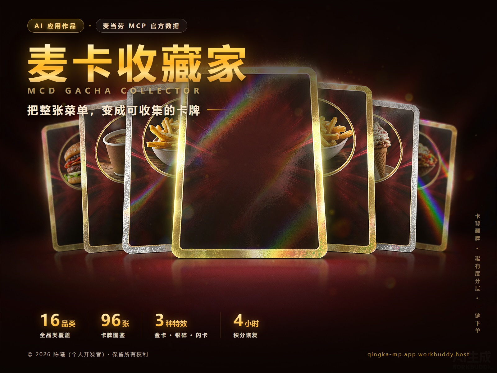

# 🍟 麦卡收藏家 · 完全使用说明

> 从零开始，10 分钟上手。全流程五步，**装完就能抽卡点餐**。

---

## 📋 你需要准备什么

| # | 准备项 | 说明 | 必须？ |
|---|---|---|---|
| 1 | **WorkBuddy** | 桌面版或网页版均可 | ✅ 必须 |
| 2 | **手机号** | 用于登录麦当劳 MCP 开放平台拿 Token | ✅ 必须 |
| 3 | **网络** | 要能访问 `open.mcd.cn` 和 `mcp.mcd.cn` | ✅ 必须 |
| 4 | 微信/支付宝 | 最后付款用 | ⭕ 下单时需要 |

**先看效果**：不想折腾？直接打开在线版 → <https://qingka-mp.app.workbuddy.host/>
（在线版含完整卡池、翻牌演出、卡面特效、收藏册；数据存在浏览器本地）

> ⚠️ **在线版是「功能展示版」**：
> 可以抽卡、玩收藏册、看卡面特效，**但不提供门店定位，也不提供实际点餐**。
> 这两项能力需要你在 WorkBuddy 中安装本 Skill 才能用（见下文）。

---

## 🗺️ 全流程速览

```
① 申请 Token      ② 配置 MCP      ③ 导入 Skill      ④ 开始抽卡      ⑤ 点餐下单
 open.mcd.cn   →   填 Token   →   拷目录     →    说「抽卡」   →   说「买xx」
   3 分钟          2 分钟        1 分钟        1 分钟          1 分钟
```

---

# 第 ① 步 · 申请麦当劳 MCP Token

**这一步是唯一需要手动操作的地方**，之后全自动。

### 1.1 打开开放平台

访问 👉 <https://open.mcd.cn/mcp>

### 1.2 登录

用**手机号**登录（会收到验证码）。

### 1.3 激活并复制 Token

登录后进入「控制台」，找到 MCP 服务的**激活/授权**按钮：

```
① 点「激活」
② 页面显示一串 Token，形如 ghp_xxxxxxxxxxxxxxxx
③ 点「复制」—— ⚠️ 只显示一次，复制完先别关页面
```

> 💡 Token 相当于你麦当劳开放平台的**专属钥匙**。它只存在你本机，
> 我们（Skill）不会上传、不会存储、不会转给任何人。

---

# 第 ② 步 · 配置 MCP 连接

**在 WorkBuddy 里填一次，之后永久有效。**

### 2.1 打开连接器管理

```
WorkBuddy 左侧边栏
  └─ 【专家 · 技能 · 连接器】（或直接点底部「＋」图标）
      └─ 右上角【自定义连接器】
          └─ 【配置 MCP】
```

### 2.2 粘贴配置

本仓库提供了现成配置：`mcp-config.example.json`，内容是：

```json
{
  "mcpServers": {
    "mcd-mcp": {
      "type": "streamablehttp",
      "url": "https://mcp.mcd.cn",
      "headers": {
        "Authorization": "Bearer ${MCD_MCP_TOKEN}"
      }
    }
  }
}
```

**两种填法，选一种：**

#### 方式 A · 直接粘贴 Token（最简单，推荐新手）

把上面配置里的 `${MCD_MCP_TOKEN}` **替换成你的真实 Token**：

```json
{
  "mcpServers": {
    "mcd-mcp": {
      "type": "streamablehttp",
      "url": "https://mcp.mcd.cn",
      "headers": {
        "Authorization": "Bearer ghp_你的真实Token"
      }
    }
  }
}
```

#### 方式 B · 用环境变量（更安全，推荐懂技术的）

保持 `${MCD_MCP_TOKEN}` 不变，把 Token 存进环境变量：

```bash
# Windows PowerShell
[Environment]::SetEnvironmentVariable("MCD_MCP_TOKEN", "ghp_你的真实Token", "User")

# macOS / Linux
export MCD_MCP_TOKEN=ghp_你的真实Token
```

> 保存后**重启 WorkBuddy** 才生效。

### 2.3 启用

点【保存】→ 【启用】。

### 2.4 验证连上了没

在 WorkBuddy 对话框输入框随便打一句：

```
现在几点？
```

如果 AI 能正常回答时间（而不是报「找不到工具」），说明 **MCP 已连通** ✅

> ❌ 报 401 / unauthorized → Token 错了或过期了，回 ① 步重新激活
> ❌ 报「找不到 mcd 工具」→ 配置没保存成功，检查 JSON 格式和【启用】是否点了

---

# 第 ③ 步 · 导入 Skill

Skill 就是「一套让 AI 知道怎么玩这个游戏的操作手册 + 抽卡引擎」。

### 3.1 克隆仓库

```bash
git clone https://github.com/ilAoC/mcd-gacha-collector.git
```

### 3.2 拷进 WorkBuddy 技能目录

**Windows**（PowerShell 或 CMD）：
```bash
xcopy /E /I /Y mcd-gacha-collector\skills\mcd-gacha-collector "%USERPROFILE%\.workbuddy\skills\"
```

**macOS / Linux**：
```bash
cp -r mcd-gacha-collector/skills/mcd-gacha-collector ~/.workbuddy/skills/
```

### 3.3 验证

在 WorkBuddy 对话框输入：

```
抽张麦当劳卡
```

AI 应该开始问你位置了 → 说明 **Skill 已生效** ✅

> 💡 也可以直接在 WorkBuddy 对话框里说「找一下 mcd-gacha-collector 这个技能」，
> 让 AI 帮你完成安装。

---

# 第 ④ 步 · 开始抽卡

## 4.1 三阶段引导

Skill 会**按顺序**带你走完三步，全程自动：

```
🅰️ 阶段 A · 接入检查    检查 MCP，没配会给申请指引
🅱️ 阶段 B · 门店定位    问你在哪，列出最近的门店让你挑
🅲 阶段 C · 抽卡确认    确认抽卡范围与次数 → 开抽
```

## 4.2 实际对话示例

**你**：抽卡

**AI**：
```
📍 你在哪个位置？
我需要找到离你最近的麦当劳，才能给你准确的价格。
回我一句话就行，比如「北京市朝阳区朝阳站」或「沈阳国际软件园」
```

**你**：沈阳国际软件园

**AI**：
```
🏪 附近有 5 家麦当劳：
┌────────────────────────────────────────┐
│ 🚗 12 米     麦当劳沈阳国际软件园餐厅      │
│ 🚗 780 米    麦当劳白塔河二路环球港动感城  │
│ 🚗 2.4 公里  麦当劳全运路万达餐厅         │
└────────────────────────────────────────┘
回复数字选一家👆
```

**你**：第一个

**AI**：
```
🎴 开抽前确认两件事👇

┌─ ① 抽卡范围 ────────────────────────┐
│ 💰 不限 / ≤30元 / ≤50元 / ≤100元       │
└──────────────────────────────────────┘
┌─ ② 抽几张 ──────────────────────────┐
│ 🎴 单抽×1 / 五连×5 / 十连×10          │
└──────────────────────────────────────┘
```

**你**：≤50 元 · 十连

**AI**：开始演出 → 逐张翻牌 → 给出结果

## 4.3 可以直接说的快捷指令

| 你说 | AI 会做 |
|---|---|
| `抽卡` | 走完整三阶段引导 |
| `50元内十连` | 参数齐了，直接开抽 |
| `换个城市` | 重新定位门店 |
| `我的收藏册` | 列出已收集的卡 |
| `再来五张` | 继续抽（会先确认范围）|
| `买不素之霸三件套` | 走下单流程 |

---

# 第 ⑤ 步 · 看积分 / 点餐下单

## 💰 积分：两套系统，别搞混

| | **Skill 对话端** | **网页端** |
|---|---|---|
| 初始积分 | **5 分** | **5 分** |
| 每次抽卡消耗 | 1 分 | 1 分 |
| 上限 | 5 分 | **30 分** |
| 恢复方式 | ⏰ **每 4 小时自动恢复 1 分** | 🔄 **点「刷新积分」立即补满 30 分**（60 秒冷却）|
| 存在哪 | `tmp/ledger.json` | 浏览器 localStorage |

### 怎么看剩余积分

**网页端**（推荐，最直观）：
打开 <https://qingka-mp.app.workbuddy.host/> → 右上角积分数字



**Skill 对话端**：直接问它

```
我还剩多少积分？
```

它会告诉你当前积分、下次恢复时间。

### 积分不够了怎么办

**网页端**：点右上角【刷新积分】→ 立即补满 30 分（60 秒冷却防连点）

**Skill 端**：只能等（4 小时恢复 1 分），或者：
- 减少抽卡数量（单抽只要 1 分）
- 等恢复时间到

> ⚠️ **积分是这个游戏自己设计的玩法机制**，跟麦当劳官方积分账户**毫无关系**，
> 不消耗也不影响你的真实积分。

---

## 🛒 点餐下单（从抽卡到付款）

### 5.1 流程图

```
你：买不素之霸双层牛堡三件套
  ↓
AI：调 query-meals 拿该门店实时在售与编码
  ↓
AI：调 calculate-price 核价（含优惠/配送费）
  ↓
AI：复述「餐品 + 门店 + 总价」⏸ 等你确认
  ↓
你：确认下单
  ↓
AI：调 create-order → 拿到 orderId + 支付链接
  ↓
你：点链接付款
```

### 5.2 完整对话示例

**你**：买可乐

**AI**：
```
🧾 订单确认
┌────────────────────────────────────┐
│  🥤 可乐 ×1                │
│     ¥9.50                     │
│────────────────────────────────────│
│  商品原价     ¥9.50        │
│  优惠          -¥0.00       │
│  打包费/餐具费  ¥0.00       │
│────────────────────────────────────│
│  💰 应付合计  ¥9.50       │
└────────────────────────────────────┘

📍 麦当劳沈阳国际软件园餐厅
🍽️ 堂食（店内用餐）

⏸ 确认下单吗？回复「确认下单」我就创建订单
```

**你**：确认下单

**AI**：
```
✅ 订单已创建
订单号：1234567890
💳 支付链接：https://...
```

**你**：点链接付款 → 完成 ✅

### 5.3 ⚠️ 重要安全机制

| 规则 | 说明 |
|---|---|
| **必须先核价** | AI 一定会先调 `calculate-price`，把总价（含优惠、配送费）念给你听 |
| **必须你点头** | 只有你明确说「确认下单 / 买 / 就这个」，才会真正创建订单 |
| **不会乱下单** | 你只是问「多少钱」「看看」时，AI **绝不会**创建订单 |
| **取餐方式要选** | 核价时会问你「堂食」还是「外带（取餐柜）」|

### 5.4 下单常见问题

**Q：AI 说「这个商品该门店没在售」**
A：门店菜单随时段变（早上早餐档、午晚正餐档）。换个时段再来，或换一家门店。

**Q：点餐时提示要 beCode**
A：选「得来速（车道取餐）」时会需要。先用「到店自取」定位门店即可绕过。

**Q：能不能一次买好几张卡里的东西**
A：可以。跟 AI 说「巨无霸三件套和麦辣鸡腿腿堡三件套都买」，AI 会一起核价给你确认。

**Q：价格和网页上不一样**
A：正常。网页是**展示用参考价**，Skill 端是**你所在门店的实时核价**，后者才是真实应付金额。

---

# ❓ 常见问题 FAQ

### Q1. 一定要装 Skill 吗？
**网页端不用**，直接开 <https://qingka-mp.app.workbuddy.host/> 就能玩。
**但要「AI 帮你点餐」就必须装**——点餐功能靠 Skill 里的引导流程和强制二次确认机制。

### Q2. Token 会被上传吗？
**不会。** Token 只写在你本机的 MCP 配置里，AI 调用时是直接向 `mcp.mcd.cn` 发请求。

### Q3. 抽到的卡能直接买吗？
**能。** 这就是核心玩法——卡上带 `product_code`，下单时 AI 直接用门店编码下单，不用手输。

### Q4. 卡池有多少张？
- **网页端**：96 张（73 张原卡 + 23 张独立闪卡变体），覆盖 13 个品类，100% 官方卡图
- **Skill 对话端**：按你所在门店的实时菜单构建（30~90 张），时段不同数量不同，价格准

### Q5. 稀有度怎么算的？
**分层抽样**：按价格分四层（≤15 / 15~30 / 30~50 / >50 元），
每层内部按「价格 50% + 热量 30% + 蛋白 20%」的价值分排序，前 25% 为 SSR。
所以**每个价格档里都有 SSR**——15 元预算也能抽到金卡。

### Q6. 什么是金卡 / 银碎 / 闪卡？
纯装饰的卡面特效，与稀有度和健康度无关：

| 特效 | 视觉 | 出现率 |
|---|---|---|
| 👑 金卡 | 满卡鎏金粒子 + 金色光轮 | SSR 34% / UR 5% / R 0% |
| 🥈 银碎 | 银色箔片 + 冷光轮 | SSR 30% / UR 22% / R 3% |
| ✨ 闪卡 | 彩虹流光扫过 | 独立卡项，SSR/UR 约 45% 有闪卡版 |

### Q7. 健康度和稀有度是一回事吗？
**不是，正交的两个维度。**
健康度回答「好不好」（依据《体重管理指导原则 2024》），稀有度回答「值不值得收集」。
贵的不一定健康，健康的不一定稀有。

### Q8. 忘记 Token 了 / 换了设备
回第 ① 步重新激活，重新填一次配置即可。

### Q9. 想换城市玩
直接说「换个城市」或「换家店」，Skill 会重新走阶段 B。

---

# 🔧 排障速查表

| 症状 | 原因 | 解决 |
|---|---|---|
| AI 说「找不到 mcd 工具」 | MCP 没配好或没启用 | 回第 ② 步，检查 JSON + 点【启用】 |
| 调用报 401 unauthorized | Token 错误/过期 | 重新激活，替换配置 |
| AI 不问参数就抽了 | 旧版 Skill | 重新拷一次（第 ③ 步），确保覆盖原目录 |
| 抽卡说「该门店没在售」 | 时段问题（现在可能是早餐档） | 等到午餐档，或换门店 |
| 网页打不开卡图 | 网络/CDN | 图片来自 `menu-img.mcd.cn`，检查网络 |
| 积分显示 0 且刷不出来 | Skill 端积分靠时间恢复 | 网页端可用（点刷新），或等 4 小时 |

---

# 📎 附：项目资料

| 资源 | 地址 |
|---|---|
| 在线试玩 | <https://qingka-mp.app.workbuddy.host/> |
| GitHub 仓库 | <https://github.com/ilAoC/mcd-gacha-collector> |
| 麦当劳 MCP 平台 | <https://open.mcd.cn/mcp> |
| 配置样例 | `mcp-config.example.json` |

---

<div align="center">

**🍟 麦卡收藏家 · MCD GACHA COLLECTOR**

把整张菜单，变成可收集的卡牌

*© 2026 陈曦（个人开发者）· 保留所有权利*

</div>
