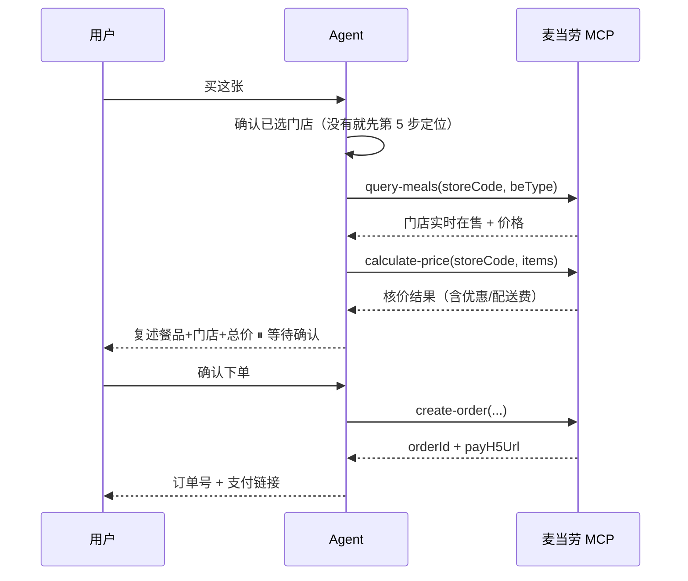

# 麦卡收藏家 · mcd-gacha-collector

## 这个 Skill 解决什么问题

麦当劳有 160+ 餐品，但每个餐品的热量、蛋白质、钠含量是多少，很多人说不清。
本Skill 把餐品变成**可收集的卡牌**：每张卡标注价格与营养数据，按健康度划分稀有度，
抽到的卡可以直接转成真实订单。

它是个**纯游戏化玩法**，不是营养建议工具，也不是官方积分体系。

本 Skill 的分工非常明确：

- **MCP 负责「取数」**：餐品营养数据、门店实时菜单与价格。
- **`scripts/gacha.py` 负责「算」**：健康度评分、稀有度划分、加权抽卡、积分账本。
- **`scripts/render.py` 负责「画」**：渲染卡牌与收藏册 HTML（与网页端同视觉）。
- **你（Agent）负责「说」和「做」**：把卡讲成人话、记收藏、经确认后下单。

> **网页/Agent 双端同步**：网页端构建产物 `tools/data.json` 是双方共享的卡池源（含 53 张卡、
> 套餐独立算法、MCP 真实图源）。`scripts/gacha.py` 会自动读取该文件，**保证两端抽到的卡牌口径完全一致**。

> 核心纪律：**永远不要自己口算健康度、稀有度或抽卡结果**。
> 一切以 `gacha.py` 的输出为准。

## 何时使用

触发场景举例：

- "抽张麦当劳卡"
- "50 元内抽一张"
- "我想集齐麦当劳所有餐品"
- "我的收藏册有哪些卡"
- "抽到的卡能直接买吗"
- "看看我能抽到什么级别的卡"

## 稀有度规则（综合收藏价值，与健康度完全解耦）

**核心设计原则**：稀有度回答「值不值得收集」，健康度回答「好不好」。
两者是**正交维度**——若稀有度由健康度决定，会出现
「高热量低营养 = R 档」这类误导，玩家会误以为 R 档就是差。

### 综合收藏价值分（0~1）

```
价值分 = 价格 × 50% + 热量载荷 × 30% + 蛋白含量 × 20%

  价格    = min(价格 / 62.5, 1.0)     # 62.5 元为卡池最高价
  热量载荷 = min(热量 / 1000, 1.0)     # 1000 kcal 为正餐基准
  蛋白含量 = min(蛋白 / 40, 1.0)      # 40 g 为卡池最高值
```

三个维度都是**「越高越稀有」**，但衡量的都是**收集价值**，不是营养质量。

### 分档（按卡池内分位数）

| 稀有度 | 价值分区间 | 含义 |
|---|---|---|
| **SSR** | 前 25% | 贵重正餐，最难收集 |
| **UR** | 42% ~ 75% | 中价位正餐 |
| **R** | 后 58% | 平价小件 |

抽卡权重 SSR 5% / UR 20% / R 75%。

**为什么用分位数**：各门店菜单结构差异大（实测沈阳站店无 D 档高价单品），
固定分数线会导致某些门店抽不到 SSR。

### 解耦验证（parity_check 强制断言）

| 稀有度 | 价值分 | 健康度区间 |
|---|---|---|
| SSR | 0.74 ~ 0.99 | 57.0 ~ 81.9 |
| UR | 0.27 ~ 0.72 | 56.6 ~ 79.7 |
| R | 0.07 ~ 0.27 | 64.8 ~ **85.3** |

- 全卡池**最低健康度 56.6 是 UR**，**最高健康度 85.3 是 R**（大杯鲜萃咖啡）
- 最高价值 0.990 的培根安格斯厚牛堡三件套，健康度只有 57.0
- 两维度完全正交，parity_check 同时断言「价值分随稀有度单调」+「健康度区间重叠」

---

## 健康度评分（依据《体重管理指导原则（2024 年版）》）

健康度评分 0~100，**依据国家卫生健康委《体重管理指导原则（2024 年版）》的摄入量标准**
由三项加权得出（**仅用于游戏化分级，不是营养建议**）：

| 维度 | 权重 | 依据原则 | 说明 |
|---|---|---|---|
| 单餐能量占比 | 40% | 「每日减少 500~1000 千卡」「三餐早30%/午40%/晚30%」 | ≤640 kcal 满分（减重期上限），≥1000 kcal 零分 |
| 蛋白质密度 | 30% | 「蛋白质供能 15~20%，减重期 20~30%」 | 每 100 大卡含多少克蛋白，≥15g 满分 |
| 低钠 | 30% | 「减少高糖、高油、高盐食物」 | 钠 0 最优，2000mg 以上 0 分 |

### 参考常量

| 常量 | 值 | 出处 |
|---|---|---|
| 日均参考摄入 | 2000 kcal | 成年轻体力活动者 |
| 一餐基准 | 800 kcal | 2000 × 午餐占比 40% |
| 减重期单餐上限 | 640 kcal | 基准的 80%（配合每日 500~1000 kcal 缺口） |
| 高能量食物红线 | 1000 kcal | 占日均 50% |

### 套餐用独立算法

套餐本身就是**一整顿**，需按整餐视角评估（否则集体低分）：

| 维度 | 权重 |
|---|---|
| 蛋白质密度 | 35% |
| 钠密度 | 30% |
| 整餐能量占比（1000 kcal 满分，1200 kcal 零分） | 35% |

套餐与单品**分别计算分位阈值**，两者的评分口径不同
（套餐满分基准 1000 kcal，单品 640 kcal）。

> ⚠️ 注意：**健康度不再决定稀有度**。评分只用于展示与排序，
> 稀有度请见上文「稀有度规则（与健康度完全解耦）」。

### 卡面标签体系（原始克数不展示）

卡面只显示**四个通俗等级标签**，不显示蛋白质/脂肪/钠的原始克数——
降低认知负担，原始数据仅在点击详情时呈现。

| 标签 | 判定 | 依据原则 |
|---|---|---|
| **能量** | ≤640 kcal 轻 / ≤800 kcal 中 / 其余重 | 一餐基准 800 kcal（午餐占 40%），减重期上限 640 |
| **蛋白** | 供能比 ≥20% 高 / ≥12% 中 / 其余低 | 蛋白质供能 15~20%，减重期 20~30% |
| **脂肪** | 供能比 ≤30% 低 / ≤42% 中 / 其余高 | 脂肪供能 20~30% |
| **钠** | 钠密度 ≤120 mg/100kcal 低 / ≤220 中 / 其余高 | 「减少高盐食物」，每日 <2000mg |

实测三档分布（53 张卡）：能量 32/6/14、蛋白 14/19/12、脂肪 18/19/7、钠 20/20/7——
三档都有卡，不会出现「全是高」或「全是低」。

**阈值依据实测分布设定**，而非直接照搬原则区间：照搬会导致绝大多数餐品落在一档，
标签失去区分度。原则给的是方向，实测分布决定分界点。

### 新算法带来的分级变化

引入「单餐能量占比」后，超出一餐基准的餐品明显降档：

| 餐品 | 热量 | 占日摄入 | 旧档位 | 新档位 |
|---|---:|---:|:---:|:---:|
| 大杯鲜萃咖啡 | 13 kcal | 0.7% | SSR | **SSR** |
| 麦麦脆汁鸡-琵琶腿 | 173 kcal | 8.6% | UR | **SSR** ↑ |
| 巨无霸三件套 | 949 kcal | 47.4% | SSR | **UR** ↓ |
| 培根蔬萃双层牛堡三件套 | 878 kcal | 43.9% | UR | **SSR** ↑ |

## 工作流

### 第 0 步：确认参数

开始前明确这几件事，缺哪个问哪个（不要反复追问，按语气判断）：

1. **预算**：用户可接受的单次抽卡预算，如"50 元内"。用户没说就问，或默认不限制。
2. **抽卡次数**：默认 1 次。用户说"来十连"就是 10 次。
3. **积分不足时怎么办**：告知恢复时间，或建议等恢复。

### 第 1 步：通过 MCP 取数

按顺序调用：

1. `now-time-info` ——拿当前时间，判断活动与餐品供应时段。
2. `query-nearby-stores` —— 确定门店（到店场景）。
3. `delivery-query-addresses` + `delivery-query-stores` —— 外送场景定位门店。
4. `query-meals` —— **拉取当前门店可售菜单与价格**（卡牌价格来源）。
5. `list-nutrition-foods` —— **拉取全量餐品营养数据**（卡牌热量来源）。

> 注意：`list-nutrition-foods` 是全平台全量餐品（约 160 项），`query-meals` 是当前门店实际在售。
> **卡池只保留两者交集**——门店卖不到的餐品不进卡池，否则用户抽到买不到。

### 第 2 步：归一化数据并构建卡池

把 MCP 结果整理成 `scripts/sample_data/` 里的两种结构，写到工作临时目录：

```
tmp/nutrition.json   # {"items": [{productName, energyKcal, protein, fat,
                #                carbohydrate, sodium, calcium, energyKj}, ...]}
tmp/prices.json      # {"prices": {"巨无霸": 22.0, ...}}
```

字段映射详见 [`references/mcp-tools.md`](references/mcp-tools.md)。

然后构建卡池并检查：

```bash
python scripts/gacha.py tmp --inspect --budget 50
```

输出会告诉你卡池总数、三档分布、SSR 占比是否合理、预算内有多少张可抽。

### 第 3 步：抽卡

```bash
# 单抽（预算 50 元内）
python scripts/gacha.py tmp --draw 1 --budget 50 --ledger tmp/ledger.json

# 十连
python scripts/gacha.py tmp --draw 10 --budget 50 --ledger tmp/ledger.json
```

返回里值得讲给用户的字段：

- `drawn[]` —— 抽到的卡，含稀有度、价格、热量、蛋白质、钠、健康度。
- `recover` —— 本次恢复了多少积分、距离下次恢复还有几小时。
- `stats` —— 收藏册总览：已收集数、三档分布、平均热量、平均健康度。
- `next_recover_at` —— 下次积分恢复时间（积分不足时告诉用户这个）。

**积分不足时**（返回 `success: false`）：如实告知还差多少、下次恢复时间，不要编造。

### 第 4 步：把结果讲给用户 + 打开网页

**核心原则：网页 `docs/index.html` 是唯一的可视化形态**，不要单独渲染独立 HTML。

Skill 端的 `scripts/render.py` 仅作离线导出（如本地截图测试），不在对话流程里跑。

正确的呈现流程：

1. **文字告诉用户**：把 `drawn[]` 里的卡牌字段用自然语言讲出来——
   卡名、稀有度、价格、热量、蛋白质、钠、健康度评分（按重要性递减）。
   **不要复述全部字段**，挑用户最关心的几个。
3. **展示网页**：用 `present_files` 打开 `docs/index.html`，
   卡片在网页里有完整的抽卡演出（卡背翻牌、SSR 光效、粒子等）。
   网页端自带统计条 + 收藏册视图，点击卡牌可看详情弹窗。
4. **不要生成 `cards.html` / `skill-card.html` 等独立 HTML**——那是冗余产物，
   会污染对话并破坏「网页=统一入口」的设计意图。

### 第 5 步：定位门店（用户首次进入 / 要求换店时）

卡池价格来自构建时的采样门店，**对其他城市的用户不准**。要让价格真实，
必须先定位用户所在门店：

1. 问清两件事：**城市** + **地点关键词**（如「北京」「朝阳站」），
   以及取餐方式（到店自取 `beType=1` / 得来速 `beType=5`）。
2. 调 `query-nearby-stores`（`searchType=2`，传 city / keyword / beType）。
3. 返回门店列表时**必须带 `distance`（到店距离）并按距离升序**，
   同时展示门店名、地址、营业时间，让用户挑一家。
4. 用户选定后，把该 `storeCode` / `beCode` 作为后续所有调用的门店上下文。

> 注意：MCP 返回的 `longitude` / `latitude` 实测恒为 `0.0`，
> **不能**用坐标计算距离，只能用官方返回的 `distance` 字段。
> 也不要承诺「自动定位」——浏览器 GPS 无法直接换算门店，
> 一律走「城市 + 地点关键词」搜索。

### 第 6 步：真实下单（强制二次确认，不可跳过）

用户点击「立即购买」或说「买这张 / 就这个」时，**严格按顺序**执行：



**铁律**：

1. **必须先调 `calculate-price` 核价**，并把最终总价（含优惠、配送费）复述给用户。
2. **必须等用户明确说「确认/下单/买」才可调 `create-order`**。
   用户只说「看看」「多少钱」时**绝不下单**。
3. 用户说「换一家」「改价格」→ 回到第 5 步重新定位，不要在旧门店硬下。
4. 下单成功后把 `payH5Url` 完整给出，并提示**订单有效期**（超时可能自动取消）。
5. 用户要取消 → `cancel-order`（需 `orderId`，并复述取消原因后再执行）。

> `create-order` 会**真实创建订单并占用库存/产生待支付款项**，
> 是不可逆的对外动作。未经用户明确同意绝不执行。
> 网页端同理：后端用一次性 `quoteToken` 强制「先核价、后确认、再下单」，
> 伪造 token 会被直接拒绝。

## 卡面图片约定

**默认来源：MCP 真实菜单图。** `query-meals` 返回的 `meals[].image` 是麦当劳官方菜单图
（CDN: `menu-img.mcd.cn`），已自动注入 `Card.image_url`，渲染时优先使用。

回退路径：当卡片缺少 `image_url`（如自定义卡池）时，使用 `Card.image_path` 字段，
约定如下：

```
assets/cards/{rarity}_{餐品名}.png
# 例：assets/cards/ssr_浓缩咖啡.png
#     assets/cards/ur_纯牛奶（盒装）.png
#     assets/cards/r_巨无霸.png
```

缺失图片时页面会自动显示占位图标（按品类 emoji），不会报错。
若要批量生成卡池中所有卡的占位清单：

```bash
python scripts/gacha.py tmp --inspect
# 从输出的 image_path 字段取全部路径
```

## 硬性约束

- **积分机制是本地游戏化的**，与麦当劳官方积分账户（`query-my-account`）相互独立，
  不消耗也不影响用户真实积分。**不要向用户暗示这是麦当劳官方积分。**
- 健康度评分与稀有度仅供趣味参考，**不构成医疗、营养或健康建议**。
- 价格与营养数据一律以 **MCP 实时返回**为准；本地示例数据只是结构示例。
- 绝不编造不存在的餐品、价格或营养数据。MCP 没返回的餐品不能进卡池。
- 卡池只用「门店在售 ∩ 平台有营养数据」的交集，避免抽到买不到的卡。
- 描述卡牌时只陈述客观数据（价格、热量、健康度评分），**不对麦当劳产品做主观评价**，
  不使用"好吃""垃圾"等口味化表述，也不与其他品牌做对比。

## 资源索引

- [`scripts/gacha.py`](scripts/gacha.py) —— 核心引擎：健康度评分 / 稀有度划分 / 加权抽卡 / 积分账本 / 收藏册。
- [`scripts/render.py`](scripts/render.py) —— 卡牌与收藏册 HTML 渲染器（**仅用于离线导出**，不在 Skill 对话流程里跑）。
- [`scripts/selftest.py`](scripts/selftest.py) —— 130 项自测，改动逻辑后必跑。
- [`scripts/sample_data/`](scripts/sample_data/) —— 离线示例：营养数据与价格（结构对齐 MCP 返回）。
- [`references/mcp-tools.md`](references/mcp-tools.md) —— MCP Tool 清单与字段映射表。
- [`assets/cards/`](assets/cards/) —— 卡面图片存放目录（用户自制）。