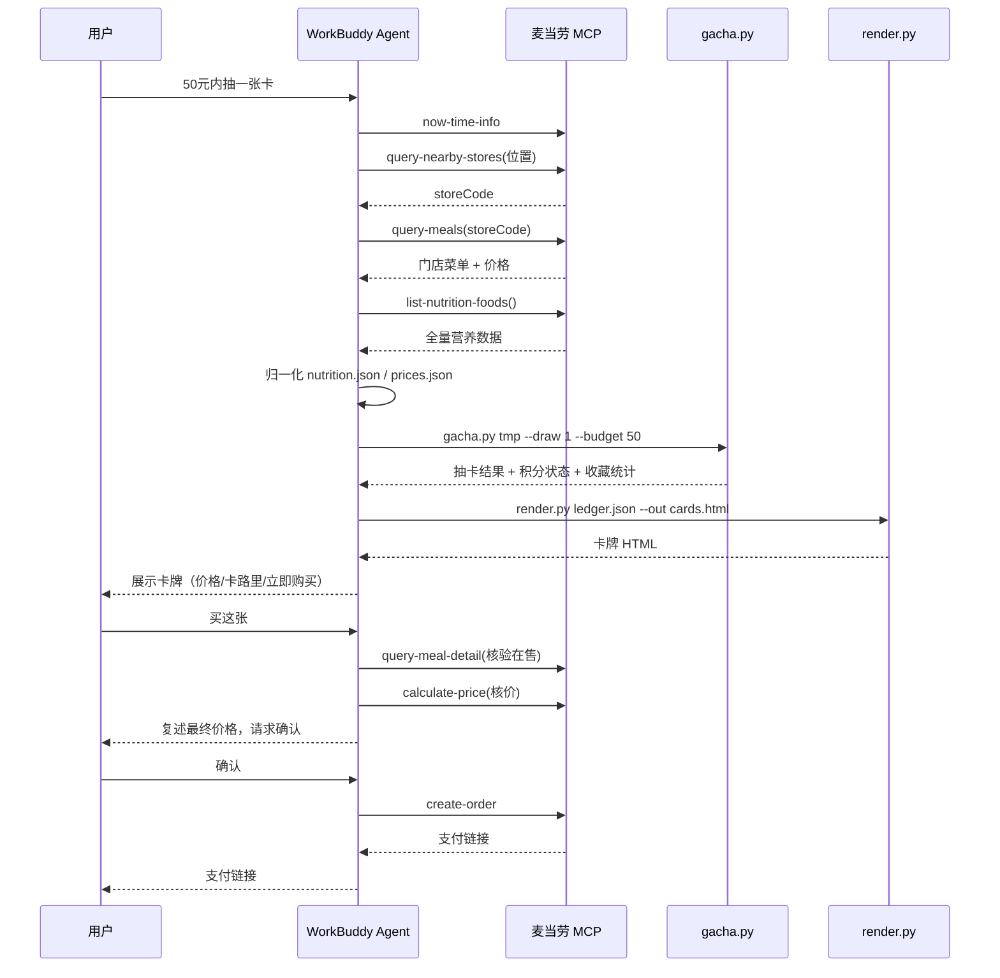

# MCP Tool 清单与字段映射

本文档说明「麦卡收藏家」实际调用的麦当劳 MCP Tool 与数据流转。

## 一、使用的 MCP Server

| 项目 | 值 |
|---|---|
| Server 名称 | `mcd-mcp` |
| 接入地址 | `https://mcp.mcd.cn` |
| 传输协议 | Streamable HTTP |
| 鉴权方式 | 请求头 `Authorization: Bearer <MCD_MCP_TOKEN>` |
| 限流 | 每 Token 600 次/分钟，超限返回 429 |
| 配置示例 | `mcp-config.example.json`（仅含环境变量占位符） |

## 二、使用的 Tool 清单

| # | Tool | 用途 | 卡牌数据的贡献 |
|---|---|---|---|
| 1 | `now-time-info` | 获取当前时间，判断时段与活动 | — |
| 2 | `query-nearby-stores` | 定位附近门店（到店场景） | 提供 storeCode |
| 3 | `delivery-query-addresses` | 查询配送地址（外送场景） | 外送定位 |
| 4 | `delivery-query-stores` | 查询可配送门店 | 提供 storeCode |
| 5 | `query-meals` | **查询当前门店可售菜单与价格** | **卡牌价格来源** |
| 6 | `query-meal-detail` | 确认餐品在售与套餐详情 | 购买转单前核验 |
| 7 | `list-nutrition-foods` | **全量餐品营养数据** | **卡牌热量/蛋白/钠来源** |
| 8 | `calculate-price` | 商品价格计算 | 下单前核价 |
| 9 | `create-order` | 创建订单，返回支付链接 | 「立即购买」转单 |

> 核心数据源是 `list-nutrition-foods`（约 160 项）与 `query-meals`（门店实时价格）。
> 卡池取两者**交集**，避免抽到门店不售的餐品。

## 三、调用流程



## 四、字段映射表

### `list-nutrition-foods` → `nutrition.json`

MCP 返回为紧凑文本格式，归一化后写入 `nutrition.json` 的 `items[]`：

| MCP 字段 | 归一化字段 | 说明 |
|---|---|---|
| `productName` | `productName` | 餐品名，用于与价格表关联 |
| `energyKcal` | `energyKcal` | 热量（kcal），卡面「千卡」 |
| `protein` | `protein` | 蛋白质（g），卡面展示 |
| `fat` | `fat` | 脂肪（g） |
| `carbohydrate` | `carbohydrate` | 碳水化合物（g） |
| `sodium` | `sodium` | 钠（mg），卡面展示 |
| `calcium` | `calcium` | 钙（mg） |
| `energyKj` | `energyKj` | 能量（kJ） |

示例（取自 MCP 真实返回）：
```json
{
  "productName": "巨无霸",
  "energyKcal": 513,
  "protein": 27,
  "fat": 26,
  "carbohydrate": 42,
  "sodium": 961,
  "calcium": 171,
  "energyKj": 2146
}
```

### `query-meals` → `prices.json`

| MCP 字段（items[]） | 归一化字段 | 说明 |
|---|---|---|
| `name` |作为 key | 餐品名，与营养数据关联 |
| `price` | value（元） | 卡面「价格」与购买按钮金额 |

```json
{"prices": {"巨无霸": 22.0, "板烧鸡腿堡": 21.0}}
```

### 派生字段（由 `gacha.py` 计算，非MCP 直接返回）

| 字段 | 计算方式 | 用途 |
|---|---|---|
| `health_score` | 蛋白密度 35% + 低热量 40% + 低钠 25% | 稀有度划分、卡面进度条 |
| `rarity` | health_score ≥75→SSR；≥55→UR；否则 R | 卡牌稀有度 |
| `price_tier` | 价格分档 A/B/C/D | 卡面标签 |
| `category` | 餐品名关键词匹配 | 卡面品类标签 |

## 五、业务价值

1. **把餐品营养可视化**：每个餐品的热量、蛋白质、钠含量原本是模糊概念，
   变成一张可收集、可对比的卡牌。
2. **引导更轻的选择**：把低卡高蛋白的餐品设为 SSR，让"相对更轻的选择"
   在玩法上更有吸引力，而非做营养说教。
3. **价格透明**：卡面标注门店实时价格与「立即购买」，从"想吃"到"下单"零跳转。
4. **纯本地玩法**：积分账本完全本地化，**不消耗用户真实麦当劳积分**，
   也不影响官方积分体系，无任何消费门槛。
5. **可扩展**：新增卡池只需补充 `nutrition.json` / `prices.json`，
   无需改动抽卡逻辑；卡面图片为用户自制，与代码解耦。

## 六、核验说明（供评审参考）

- `scripts/sample_data/` 中的数据为**脱敏演示样本**，字段结构与 MCP 真实返回一致，
  数值为 MCP 实际返回值；
- 真实运行时，数据从 `list-nutrition-foods` 与 `query-meals` 实时获取；
- 代码与配置中**不含任何真实 Token / 密钥 / 账号凭证**；
- 复现步骤：配置 MCP Token → 安装 Skill → 对话「50元内抽一张卡」
  → 观察 Agent 调用上述 Tool 并输出卡牌。